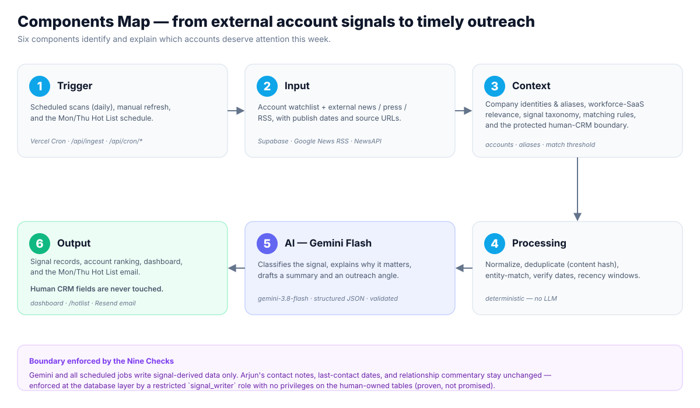

# 05 · Components Map — Executive

**From external account signals to timely outreach.**
*Six components identify and explain which accounts deserve attention this week.*



*(Editable source: [`diagrams/components-map.mmd`](diagrams/components-map.mmd) ·
PNG: [`diagrams/components-map.png`](diagrams/components-map.png))*

## The six components

| # | Component | Role | In this build |
|---|---|---|---|
| **1** | **Trigger** | Scheduled scans, manual refresh, and the Mon/Thu Hot List schedule. | Vercel Cron (`/api/cron/ingest` daily, `/api/cron/hotlist` Mon & Thu) + manual `/api/ingest`. |
| **2** | **Input** | Account watchlist plus external news / press / RSS, with publish dates and source URLs. | Supabase `accounts` + **Google News RSS** (primary) + **NewsAPI.org** (enrichment). |
| **3** | **Context** | Company identities & aliases, workforce-SaaS relevance, the signal taxonomy, matching rules, and the protected human-CRM boundary. | `accounts.aliases`, 6-category taxonomy, match threshold, human/system table split. |
| **4** | **Processing** | Normalize, deduplicate, entity-match, verify dates, apply recency windows. | Deterministic (`lib/ingestion`): `content_hash` dedup, name/alias match (≥0.6), recency decay. |
| **5** | **AI** | Classify the signal, explain why it matters, draft a summary and an outreach angle. | **Gemini Flash** `gemini-3.8-flash`, structured JSON, Zod-validated (`lib/ai`). |
| **6** | **Output** | Signal records, account ranking, dashboard, and the Mon/Thu Hot List email — human CRM untouched. | `signal_*` tables, `account_dashboard`, `/` + `/hotlist`, Resend email. |

## Flow

```
1 Trigger → 2 Input → 3 Context → 4 Processing → 5 AI (Gemini Flash) → 6 Output
```

Deterministic code owns stages 1–4 and 6 (scheduling, retrieval, dedup, matching,
date windows, scoring, writes, email). **Gemini Flash is used only in stage 5** —
classification, relevance explanation, summary, and outreach drafting. Gemini
never promotes an unsupported claim to a fact; every signal keeps its source URL.

## Boundary enforced by the Nine Checks

AI and all scheduled jobs write **signal-derived data only**. Arjun's contact
notes, last-contact dates, and relationship commentary stay unchanged — enforced
at the **database layer** by a restricted `signal_writer` Postgres role with **no
privileges** on the human-owned tables (`account_crm`, `contact_history`). This is
**proven, not promised**: as `signal_writer`, an `UPDATE` on a human table returns
`permission denied (42501)` while system writes succeed
(`supabase/tests/preservation_proof.sql`).

## Status
All six components are implemented and verified. In production, reads and the Hot
List preview run on the public URL now; app-driven ingestion and email sending
activate once the secret env vars are set on Vercel (see
[`13-DEPLOYMENT.md`](13-DEPLOYMENT.md)). See
[`COMPONENTS-MAP-TECHNICAL.md`](COMPONENTS-MAP-TECHNICAL.md) for the engineering view.
