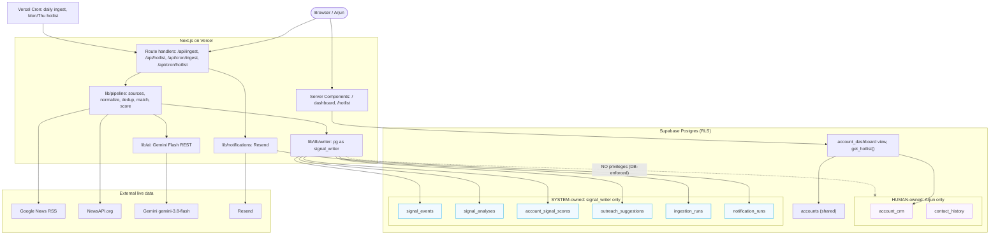

# Components Map — Technical

Engineering view of the actual implementation. Editable source:
[`diagrams/technical-architecture.mmd`](diagrams/technical-architecture.mmd).

## Modules (actual files)

| Concern | File(s) | Runtime | Notes |
|---|---|---|---|
| Dashboard / Hot List pages | `app/page.tsx`, `app/hotlist/page.tsx` | Vercel (server component) | Read via anon key from the `account_dashboard` view / `get_hotlist` RPC. |
| Ingest trigger | `app/api/ingest/route.ts` | Vercel function (node) | `GET` dry-run (no writes); `POST` full run (Bearer `CRON_SECRET`). |
| Cron targets | `app/api/cron/ingest`, `app/api/cron/hotlist` | Vercel Cron → function | `GET` + Bearer `CRON_SECRET` (Vercel injects it). |
| Hot List preview | `app/api/hotlist/route.ts` | Vercel function | `?format=html` returns the rendered email. |
| Sources | `lib/ingestion/sources.ts` | function | Google News RSS (primary) + NewsAPI (fails soft). |
| Normalize / dedup | `lib/ingestion/normalize.ts` | function | `content_hash = sha256(title|day|publisher)`. |
| Entity match | `lib/ingestion/match.ts` | function | name/alias match, threshold 0.6. |
| AI | `lib/ai/gemini.ts`, `lib/ai/analyze.ts` | function → Gemini API | `responseSchema`, `thinkingBudget:0`, Zod-validated, prompt-injection guard. |
| Scoring | `lib/scoring/score.ts` | function | Deterministic; configurable recency decay (`SIGNAL_DECAY_DAYS`). |
| Orchestration | `lib/pipeline.ts` | function | `computeAccountSignals` (pure) vs `persistAccountResults`. |
| System writes | `lib/db/writer.ts` | function → Postgres | `pg` as **`signal_writer`**; explicit column allowlists; idempotent. |
| Email | `lib/notifications/email.ts`, `hotlist.ts` | function → Resend | Preview fallback when `RESEND_API_KEY` absent. |
| DB schema | `supabase/migrations/0001–0004` | Supabase | Tables, RLS, role, view, `get_hotlist`. |

## Deterministic vs Gemini
- **Deterministic:** retrieval, dedup (`content_hash`), entity matching, date/recency
  windows, scoring math, write allowlists, idempotency, scheduling.
- **Gemini Flash only:** signal classification, relevance explanation, summary,
  outreach angle (stage 5). Structured JSON, validated before any write.

## Data-ownership boundary (the preservation guarantee)
- **Human-owned** (`account_crm`, `contact_history`): written only by an
  authenticated Arjun session (RLS). The automated path has **no DB privileges** here.
- **System-owned** (`signal_events`, `signal_analyses`, `account_signal_scores`,
  `outreach_suggestions`, `ingestion_runs`, `notification_runs`): written only by
  the `signal_writer` role.
- Proven live: `signal_writer` `UPDATE account_crm` → `permission denied (42501)`;
  reproducible via `supabase/tests/preservation_proof.sql`.

## Reliability
- Idempotent ingestion (`content_hash` unique) and idempotent email
  (`unique(run_date, kind)` on `notification_runs` — duplicate same-day send blocked).
- Source failures fail soft; Gemini retries on 5xx/429; all external text treated
  as untrusted data.

## Operational status
Implemented & verified end-to-end. In production: reads + Hot List preview live on
the public URL; app-driven ingestion, cron, and email activate when the secret env
vars are added on Vercel (`SIGNAL_WRITER_DATABASE_URL`, `GEMINI_API_KEY`,
`NEWS_API_KEY`, `RESEND_API_KEY`, `HOTLIST_TO_EMAIL`, `CRON_SECRET`).
